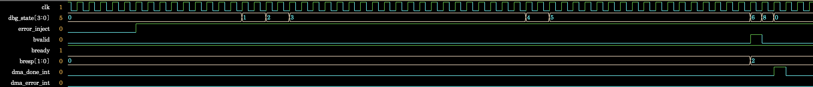
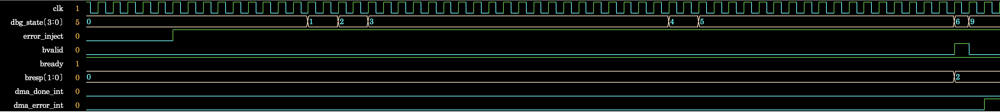

# AXI4 BRESP 오류 상태 전이 디버깅

## 개요

Step 3에서 AXI4 write response 오류 경로를 검증하기 위해 DDR 메모리 모델이
`BRESP=SLVERR`를 반환하도록 구성함. DUT는 `error_code=0x3`을 기록했지만 정상 완료
상태로 전이했으며, 로그와 FSM 코드를 분석하여 BRESP 오류 상태 전이 조건을 수정함.

## 문제 재현

S3-2 시나리오에서 64-byte write data 전송을 마친 뒤 DDR 메모리 모델이
`BRESP=2'b10`을 반환함. DUT가 write response 오류를 감지했음에도 다음 클록에서
`S_ERROR`가 아닌 `S_DONE`으로 전이함.

```text
Expected: S_WR_RESP → S_ERROR
Actual:   S_WR_RESP → S_DONE → S_IDLE
```

- 오류 재현 파형: [`bresp_error_path_failure.png`](../images/step3/bresp_error_path_failure.png)



수정 전 로그에는 `BRESP=10` 감지 직후 정상 완료 상태와 completion interrupt가
발생했으며, STATUS는 `error_code=0x3`, `error=1`, `done=1`인 `0x00000306`으로 기록됨.

```text
DMA: WRITE ERROR - BRESP=10
DMA State: WRITE_RESP
DMA: TRANSFER COMPLETED - Total 64 bytes
DMA State: COMPLETE
DMA completion interrupt received!
REG[0x04] -> 0x00000306
```

- 오류 재현 simulation log(W 채널 수정 후/BRESP 수정 전):
  [`step3_bresp_error_path_failure.log`](../../runs/debug/step3_bresp_error_path_failure.log)

## 원인 및 수정

수정 전: [`baseline/design.sv`](../../baseline/design.sv#L514)

```systemverilog
S_WR_RESP: if (m.bvalid && m.bready) begin
    if (stat.error)
        nxt = S_ERROR;
    else if (bytes_left > 0)
        nxt = S_NEXT;
    else
        nxt = S_DONE;
end
```

`S_WR_RESP` 순차 논리는 BRESP handshake 시 nonblocking assignment로 `stat.error`를
설정함. 같은 시점의 next-state 조합 논리는 갱신 전 `stat.error=0`을 참조하므로,
현재 응답이 SLVERR인데도 정상 완료 경로를 선택함.

수정 후: [`rtl/dma_controller.sv`](../../rtl/dma_controller.sv#L406)

```systemverilog
S_WR_RESP: if (m.bvalid && m.bready) begin
    if (m.bresp != 2'b00)
        nxt = S_ERROR;
    else if (bytes_left > 0)
        nxt = S_NEXT;
    else
        nxt = S_DONE;
end
```

Next-state 판단에서 현재 handshake의 `BRESP`를 직접 확인하도록 수정함. `stat.error`와
`stat.error_code`는 기존 순차 논리에서 계속 기록하여 MMIO STATUS를 통해 오류 상태를
확인할 수 있도록 유지함.

## 수정 및 재검증 결과

수정 후 `BRESP=10` 감지 직후 FSM이 `S_WR_RESP(6) → S_ERROR(9)`로 전이하고,
completion interrupt 대신 error interrupt가 발생함. STATUS도 `error_code=0x3`,
`error=1`, `done=0`인 `0x00000304`로 확인됨.

- 수정 후 파형: [`bresp_error_path_fixed.png`](../images/step3/bresp_error_path_fixed.png)



| 확인 항목 | 수정 전 | 수정 후 |
|---|---|---|
| FSM 전이 | `S_WR_RESP → S_DONE → S_IDLE` | `S_WR_RESP → S_ERROR` |
| Interrupt | Completion interrupt | Error interrupt |
| STATUS | `0x00000306` | `0x00000304` |
| Error code | `0x3` | `0x3` |
| Done | `1` | `0` |
| 64-byte data 비교 | 16 words match | 16 words match |

- 수정 후 simulation log: [`step3_simulation.log`](../../runs/step3_simulation.log)

SLVERR는 write data가 메모리에 기록된 뒤 반환되는 response이므로, 16 words의 source와
destination data가 모두 일치하면서 DUT가 오류 상태로 전이하는 결과는 의도한 동작임.
UVM summary의 error 1건은 Driver가 STATUS의 `error=1`을 보고한 결과이며, BRESP 오류
상태 전이 수정의 실패를 의미하지 않음.
