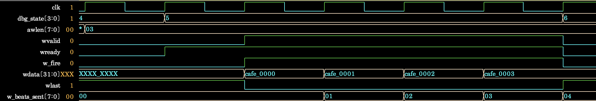
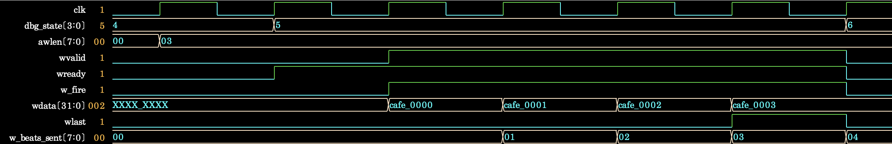

# AXI4 W 채널 WLAST 타이밍 디버깅

## 개요

Step 4 functional coverage closure 과정에서 transaction coverage와 FSM coverage는
100%를 달성했지만, AXI event coverage의 `cp_wlast_awlen`이 33.33%에 머무름.
실패 로그와 4-beat write burst 파형을 분석하여 DUT가 마지막 data handshake 이후에
`WLAST`를 활성화하는 문제를 확인하고 수정함.

## 문제 재현

최초 실행에서 `cp_awlen=100%`를 달성하여 1·4·16-beat burst가 모두 실행되었음을
확인함. 반면 같은 burst 길이에서 `WVALID && WREADY && WLAST`를 sampling하는
`cp_wlast_awlen`은 33.33%에 머물러 AXI event coverage가 92.59%, overall coverage가
97.53%로 종료되었고 최종 테스트는 FAILED로 판정됨. 시나리오 누락이 아닌 WLAST 동작
문제로 판단하여 가장 짧은 multi-beat 조건인 S1-3의 4-beat 파형을 분석함.

- Coverage gap 재현 log:
  [`step4_wlast_coverage_gap.log`](../../runs/debug/step4_wlast_coverage_gap.log)
- 문제 재현 파형: [`wlast_timing_failure.png`](../images/step4/wlast_timing_failure.png)



S1-3의 `AWLEN=3`인 4-beat 파형에서 마지막 data인 `CAFE0003`이 handshake될 때
`WVALID`, `WREADY`, `w_fire`는 1이지만 `WLAST`는 0이었음. 다음 cycle에 FSM이
`S_WR_RESP`로 전이하고 `WVALID=0`이 된 뒤에야 `WLAST=1`이 되어, 마지막 handshake에서
WLAST가 누락된 것을 확인함.

## 원인 및 수정

수정 전 WLAST 계산식: [`baseline/design.sv`](../../baseline/design.sv#L414)

```systemverilog
m.wlast <= (w_beats_sent == burst_len_m1);
```

다음 `WDATA`를 출력하면서 `WLAST`는 현재 beat 번호로 계산한 것이 원인임. 그 결과
마지막 data인 `CAFE0003`에는 `WLAST=0`이 유지되고, 전송이 끝난 뒤에야 `WLAST=1`이
되어 한 beat 늦게 나타남.

수정 후: [`rtl/dma_controller.sv`](../../rtl/dma_controller.sv#L296)

```systemverilog
else if (m.wvalid) begin
    if (m.wready) begin
        m.wdata <= wdata_hold;
        m.wlast <= ((w_beats_sent + 1) == burst_len_m1);
    end
end
```

다음 `WDATA`와 동일하게 `w_beats_sent + 1`을 기준으로 마지막 beat 여부를 계산하도록
수정함. 최초 beat의 계산식은 유지하여 1-beat burst도 정상 처리함.

## 수정 및 재검증 결과

수정 후 동일한 4-beat 구간에서 마지막 `CAFE0003` handshake와 `WLAST=1`이 같은
cycle에 발생함. 다음 cycle에는 `WVALID=0`, `WLAST=0`으로 내려가고 FSM이
`S_WR_RESP`로 정상 전이함.

- 수정 후 파형: [`wlast_timing_fixed.png`](../images/step4/wlast_timing_fixed.png)



| 확인 항목 | 수정 전 | 수정 후 |
|---|---:|---:|
| `cp_wlast_awlen` | 33.33% | 100.00% |
| AXI event coverage | 92.59% | 100.00% |
| Overall coverage | 97.53% | 100.00% |
| 검사 transaction | 37 / 37 | 37 / 37 |
| Coverage closure | 미달성 | 달성 |
| 최종 판정 | FAILED | PASSED |

- 수정 후 simulation log: [`step4_simulation.log`](../../runs/step4_simulation.log)

재실행 결과 모든 coverpoint와 cross가 100%를 달성했으며, 예상/실제 UVM error
20건 일치 및 warning·fatal 0건을 확인함. UVM summary의 error 20건은 size error와
BRESP SLVERR negative test에서 발생한 예상 결과임.
