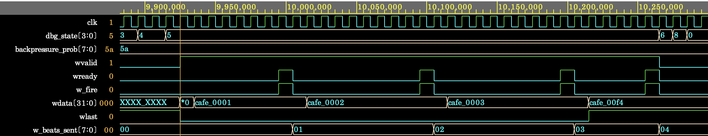
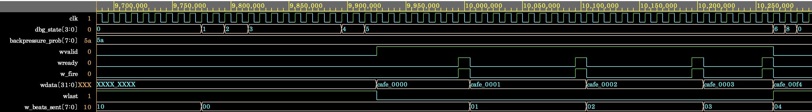
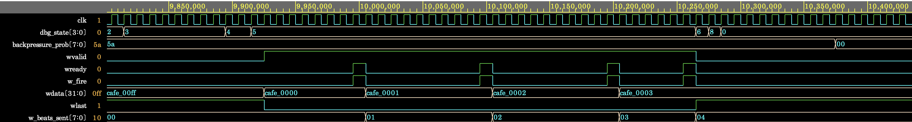

# Backpressure 환경에서 발생한 AXI4 W 채널 Data Mismatch 디버깅

## 개요

Step 3에서 기존 Step 2 시나리오에 AXI4 W 채널 backpressure를 적용하자 source와 destination data가 일치하지
않는 문제가 발생함. 로그와 파형을 분석하여 DUT의 WDATA 갱신 조건과 FIFO prefetch
조건에서 원인을 확인하고 수정함.

## 문제 재현

Backpressure를 적용하지 않은 S1은 통과했지만, backpressure를 확률적으로 발생시킨 S2와 S3-1에서
data mismatch가 발생함.

| 시나리오 | Backpressure 확률 | 수정 전 결과 |
|---|---:|---:|
| S2 — 1024B 전송 | 10% | mismatch 25건, unknown 1건 |
| S3-1 — 16B 전송 | 90% | mismatch 4건, unknown 0건 |

- 수정 전 simulation log: [`step3_w_payload_failure.log`](../../runs/debug/step3_w_payload_failure.log)
- 문제 재현 파형: [`axi_w_payload_stability_violation.png`](../images/step3/axi_w_payload_stability_violation.png)



S3-1의 source read data는 `CAFE0000`부터 `CAFE0003`까지 정상이었지만, WDATA 파형에는
이전 burst의 data인 `CAFE00F4`가 추가로 나타남.

```text
Expected: CAFE0000 → CAFE0001 → CAFE0002 → CAFE0003
Actual:   CAFE0000 → CAFE0001 → CAFE0002 → CAFE0003 → CAFE00F4
```

파형에서 `WVALID=1`이 유지되는 동안 backpressure가 반복됨. 각 `WREADY=0`,
`w_fire=0` 구간에는 handshake가 성립하지 않았으므로 `WDATA`가 유지되어야 하지만,
`CAFE0000 → CAFE0001`, `CAFE0001 → CAFE0002`, `CAFE0002 → CAFE0003`,
`CAFE0003 → CAFE00F4`로 계속 갱신됨.

Stall 중 발생한 각 data 변화는 AXI4 payload 안정성 조건을 위반하며, 이후 `w_fire`에서는 이미 다음 값으로
바뀐 data가 수락됨. 그 결과 전송 data가 한 beat씩 밀리고 마지막 handshake에서는
`CAFE00F4`가 수락됨.

(`CAFE0001` 왼쪽의 짧은 `*0` 구간이 최초 출력된 `CAFE0000`임.)

## 원인 및 수정

### 1. AXI4 W payload 갱신 조건 버그

수정 전: [`baseline/design.sv`](../../baseline/design.sv#L412)

```systemverilog
else if (m.wvalid) begin
    m.wdata <= wdata_hold;
    m.wlast <= (w_beats_sent == burst_len_m1);
end
```

기존 코드는 `WREADY`와 관계없이 `WVALID=1`이면 W payload를 갱신함. AXI4에서는
`WVALID=1`, `WREADY=0`인 동안 payload를 유지해야 하므로, handshake 전에 다음 data로
변경되는 동작은 protocol 위반임.

수정 후: [`rtl/dma_controller.sv`](../../rtl/dma_controller.sv#L269)

```systemverilog
else if (m.wvalid) begin
    if (m.wready) begin
        m.wdata <= wdata_hold;
        m.wlast <= (w_beats_sent == burst_len_m1);
    end
end
```

`WREADY` 조건을 추가하여 handshake가 성립할 때만 다음 payload를 출력하고,
backpressure 중에는 기존 값을 유지하도록 수정함.

### 2. FIFO prefetch 범위 버그

수정 전: [`baseline/design.sv`](../../baseline/design.sv#L426)

```systemverilog
if (w_beats_sent != burst_len_m1)
    wdata_hold <= fifo[rd_ptr + 2];
```

4-beat burst의 세 번째 beat에서는 마지막 data인 `fifo[3]`이 이미 준비되었는데도
기존 조건이 `fifo[4]`를 추가로 prefetch함. S3-1은 `fifo[0:3]`만 갱신하므로
`fifo[4]`에는 이전 S2 burst의 `CAFE00F4`가 남아 있었음. FIFO storage를 지우지 않는
것은 문제가 아니며, 현재 burst의 유효 data 범위를 벗어나 접근한 것이 원인임.

수정 후: [`rtl/dma_controller.sv`](../../rtl/dma_controller.sv#L285)

```systemverilog
if ((w_beats_sent + 1) < burst_len_m1)
    wdata_hold <= fifo[rd_ptr + 2];
```

`rd_ptr + 2` 위치의 후속 data가 실제로 필요한 경우에만 prefetch하도록 조건을 제한함.

## 수정 및 재검증 결과

### W payload 갱신 조건 수정 후

AXI4 W payload 갱신 조건 버그를 수정한 결과, backpressure 중 `WDATA`가 유지되어
S2와 S3-1의 data mismatch가 제거됨. 다만 마지막 handshake 이후 불필요하게 prefetch된
`CAFE00F4`가 `WDATA`에 나타났으며, `WVALID=0`이므로 실제 전송되지는 않았음.

- 파형: [`axi_w_payload_fixed.png`](../images/step3/axi_w_payload_fixed.png)



### FIFO prefetch 범위까지 수정 후

이후 FIFO prefetch 범위 버그를 수정한 결과, 마지막 `WDATA`가 `CAFE0003`으로 유지됨.
재실행 로그에서 4개 transaction 모두 Scoreboard PASS, 340 words 일치 및 예상
transaction 4건 확인을 기록함.

- 파형: [`axi_w_payload_prefetch_fixed.png`](../images/step3/axi_w_payload_prefetch_fixed.png)



| 확인 항목 | 수정 전 | 수정 후 |
|---|---:|---:|
| 전체 data 비교 | mismatch 29건, unknown 1건 | match 340건, mismatch/unknown 0건 |
| Backpressure 중 WDATA 유지 | 실패 | 정상 |
| 불필요한 `fifo[4]` prefetch | 발생 | 제거 |

- 수정 후 simulation log: [`step3_simulation.log`](../../runs/step3_simulation.log)

UVM summary의 error 1건은 S3-2에서 의도적으로 주입한 BRESP SLVERR 결과이며,
W payload 및 FIFO prefetch 수정에 대한 재검증 실패를 의미하지 않음.
